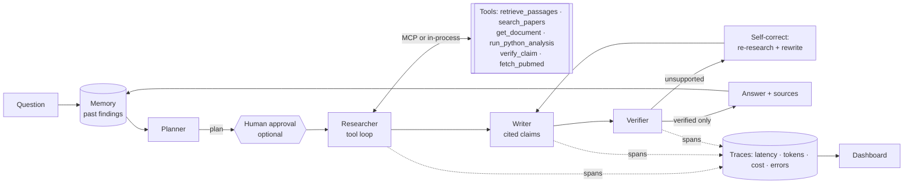

# biolens

**An agentic biomedical literature assistant that proves its answers.**
Ask a research question; a planner, researcher and writer find evidence in a paper corpus, write cited claims,
and a verifier checks every claim against the paper it cites. Unsupported claims trigger a retry, then get dropped.
Every step is traced, every tool is exposed over MCP, and the whole thing ships with an evaluation harness.



## What's inside

| Area | Implementation |
|---|---|
| **Agentic AI** | Planner / Researcher / Writer / Verifier roles with separate prompts and JSON contracts. Only the researcher is autonomous (chooses tools, decides when it has enough); everything else is deterministic orchestration. Human-in-the-loop plan approval, persistent memory, checkpoint/resume. |
| **MCP** | `biolens.mcp_server` exposes the tools to any MCP client (Claude Desktop, IDEs). The agent itself can discover and call tools through MCP (`--mcp`), proven end-to-end over stdio in the tests. |
| **Advanced RAG** | SQLite FTS5 BM25 + dense vectors → Reciprocal Rank Fusion → metadata filters (year, journal, publication type) → reranker (lexical by default, cross-encoder optional) → citation verification. |
| **Observability** | Span per agent stage, LLM call and tool call: latency, tokens, cost, errors. `biolens trace <run>` and a Streamlit dashboard. |
| **Evaluation** | Retrieval (recall@k, MRR, nDCG, BM25 vs dense vs hybrid vs +rerank ablation), answer correctness, citation precision/recall vs gold papers, raw hallucination rate, abstention accuracy, task completion, p50/p95 latency, cost. |
| **Multi-model comparison** | `biolens eval --models openai:...,gemini:...,ollama:...` runs identical questions on every model. |

## Quickstart (no API key, no internet)

```bash
pip install -e ".[dev]"          # add ,openai / ,gemini / ,rerank as needed
biolens ingest-demo              # 15 SYNTHETIC papers about a fictional disease
biolens ask "Does zorvalin reduce relapse in Marrow-Hartwell syndrome?"
biolens ask "What is the effect of zorvalin on Parkinson's disease?"   # abstains: nothing in the corpus
biolens trace $(biolens runs | head -1 | cut -d' ' -f1)
biolens eval                     # retrieval ablation + agent metrics
biolens dashboard
pytest                           # 49 tests
```

> **The demo corpus is synthetic.** It uses a fictional condition and drugs so it can never be mistaken for medical
> evidence, and it lets everything run offline. The default `mock` model is a deterministic extractive stand-in
> for testing the plumbing. **Numbers from `mock` say nothing about answer quality.**

## Using real data and real models

```bash
export OPENAI_API_KEY=...            # and/or GEMINI_API_KEY; Ollama needs no key
export BIOLENS_EMBEDDER=openai       # or st (sentence-transformers); 'hash' is lexical-only
export NCBI_EMAIL=you@example.com    # polite PubMed use; NCBI_API_KEY raises rate limits
biolens ingest "marrow disease AND randomized controlled trial[pt]" --max 200 --year-min 2018
biolens --model openai:gpt-4o-mini ask "..." --interactive --judge
```

* `--interactive` shows the plan and lets you approve, edit or reject it before any searching.
* `--judge` makes the LLM an entailment checker for citations (recommended with real models; the default
  heuristic is tuned for the offline demo and can reject legitimate paraphrases).
* Re-embedding: a corpus remembers which embedder built it; mixing embedders raises an error.
* Cost: prices change, so none are bundled. Set `BIOLENS_PRICING` to a JSON file
  `{"openai:gpt-4o-mini": {"in": 0.15, "out": 0.60}}` (USD per 1M tokens). Unpriced models show cost as *unknown*, never a guess.

### Compare models properly

1. Ingest a real corpus for one topic and write 30–50 questions in a golden JSONL (format in `evaluation.py`):
   gold `relevant_pmids`, `must_include` facts, and a few `"answerable": false` questions.
2. `biolens eval --golden my_golden.jsonl --models openai:gpt-4o-mini,gemini:gemini-2.0-flash,ollama:llama3.1`
3. Read the table: correctness, citation precision, **raw hallucination** (before the safety net), abstention accuracy, p95 latency, cost.

## MCP

```jsonc
// Claude Desktop → claude_desktop_config.json
{"mcpServers": {"biolens": {"command": "python", "args": ["-m", "biolens.mcp_server", "--home", "/abs/path/.biolens"]}}}
```

Tools: `search_papers`, `retrieve_passages`, `get_document`, `run_python_analysis`, `verify_claim`, and
`fetch_pubmed` (with `--pubmed`). The agent can use the same server: `biolens ask "..." --mcp`.

## Design decisions

* **Workflow first, agent where it pays.** A fixed pipeline is predictable and testable; the model only gets
  autonomy in the research loop, where choosing queries and filters actually helps.
* **One JSON protocol for all models**, instead of each vendor's function-calling format, so GPT, Gemini and open-weight
  models see identical prompts and the comparison is fair.
* **Never trust the writer.** Claims are re-checked against the cited text with a numeric guard (invented statistics are
  the classic failure). Citations to papers that were never retrieved are flagged as fabricated.
* **Abstention is a feature.** "Not enough evidence" is a valid, measured outcome.
* **Citation faithfulness ≠ relevance.** A claim can be faithfully supported by an irrelevant paper, so the eval also scores
  citations against gold papers.

## Limitations (read before trusting it)

* `run_python_analysis` is a best-effort sandbox (AST allow-list, restricted builtins, rlimits, timeout), not a security
  boundary. Run it in a container for untrusted use.
* Vector search is brute-force NumPy: fine to ~100k passages; swap `CorpusStore.dense` for Qdrant/pgvector beyond that.
* Retrieval is over abstracts, not full text. The default lexical reranker is a baseline; use the cross-encoder for quality.
* The Gemini/OpenAI adapters and live PubMed client follow the vendor APIs but are covered by fixtures/mocks in tests,
  not live calls.
* This is a research aid, not medical advice.

## Layout

```
src/biolens/
  agents.py      workflow, self-correction, checkpoints      tools.py / mcp_server.py   tools + MCP
  retrieval.py   hybrid + RRF + rerank                       verify.py                  citation verification
  store.py       SQLite FTS5 + vectors                       tracing.py / dashboard.py  observability
  evaluation.py  metrics + model comparison                  memory.py / state.py       persistence
  llm.py         OpenAI · Gemini · Ollama adapters           mock_llm.py                offline test model
tests/           49 tests (retrieval, verification, sandbox, agent, resume, MCP over stdio, eval, CLI, dashboard)
```
